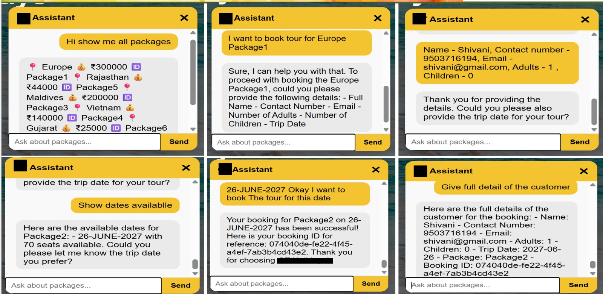

# 🌍 GT Holidays — AI-Enabled Tour Booking System

An AI-powered, serverless tour booking web application built with **React** and **AWS**. Users can browse curated tour packages, view destination image galleries, book trips with real-time seat availability, process payments, and interact with an intelligent chatbot powered by **Amazon Bedrock** that can answer questions, check availability, and even create bookings conversationally.

---

## ✨ Features

| Feature | Description |
|---|---|
| **🏖️ Browse Tour Packages** | Dynamically fetched from DynamoDB and displayed with image galleries |
| **📅 Real-Time Availability** | Check available trip dates and remaining seats for each package |
| **📝 Tour Booking** | Full booking form with auto-calculated pricing (adults + children) |
| **💳 Payment Processing** | Integrated payment form with card details and INR currency support |
| **🤖 AI Chatbot** | Amazon Bedrock Agent-powered assistant that can search packages, check dates, and create bookings through natural conversation |
| **🖼️ Image Galleries** | S3-hosted destination images rendered in interactive galleries |
| **🔔 Booking Confirmation** | Success popup with booking confirmation after submission |

---

## 🏗️ Architecture

```
┌─────────────────────────────────────────────────────────────────┐
│                         Frontend (React)                        │
│  Home • Packages • Destination • Booking • Payment • Chatbot   │
└──────────────────────────────┬──────────────────────────────────┘
                               │ HTTPS
                               ▼
                   ┌───────────────────────┐
                   │   Amazon API Gateway   │
                   │     (REST API /dev)    │
                   └───────┬───────┬───────┘
                           │       │
              ┌────────────┘       └────────────┐
              ▼                                 ▼
   ┌─────────────────────┐           ┌─────────────────────┐
   │  TourSearchLambda   │           │  TourBookingLambda  │
   │  /packages          │           │  /booking           │
   │  /reservation       │           │  /createBooking     │
   └────────┬────────────┘           └──────────┬──────────┘
            │                                   │
            ▼                                   ▼
   ┌─────────────────┐                 ┌─────────────────┐
   │  TourPackages   │                 │  TourBookings    │
   │  GT_TourTrips   │  (DynamoDB)     │    (DynamoDB)    │
   └─────────────────┘                 └─────────────────┘

              ┌──────────────────────────────────┐
              │     ChatbotInvokerLambda          │
              │     /chatbot                      │
              └──────────────┬───────────────────┘
                             ▼
              ┌──────────────────────────────────┐
              │     Amazon Bedrock Agent          │
              │  (Action Groups → Lambda APIs)    │
              └──────────────────────────────────┘
```

---

## 🛠️ Tech Stack

### Frontend
- **React 19** — UI framework
- **React Router v7** — Client-side routing
- **Vanilla CSS** — Custom styling with responsive design

### Backend (Serverless — AWS)
- **AWS Lambda** (Python) — Business logic
- **Amazon API Gateway** — REST API endpoints
- **Amazon DynamoDB** — NoSQL database for packages, trips, and bookings
- **Amazon Bedrock** — AI Agent for intelligent chatbot interactions
- **Amazon S3** — Image hosting for tour destinations
- **Amazon CloudWatch** — Logging and monitoring

---

## 📁 Project Structure

```
gt-holidays/
├── Backend/
│   ├── AWS Bedrock/
│   │   ├── Action Group/
│   │   │   ├── TourBooking          # OpenAPI schema for booking actions
│   │   │   └── TourSearch           # OpenAPI schema for search actions
│   │   └── Instructions for Agent   # Bedrock Agent system prompt
│   ├── DynamoDB Table/
│   │   ├── GT_TourTrips/            # Trip dates & seat availability
│   │   ├── TourBookings/            # Customer booking records
│   │   └── TourPackages/            # Tour package catalog
│   └── Lambda/
│       ├── ChatbotInvokerLambda     # Invokes Bedrock Agent for chat
│       ├── TourBookingLambda        # Creates bookings in DynamoDB
│       └── TourSearchLambda         # Fetches packages, dates, availability
├── Images/                          # Project screenshots
├── public/                          # Static assets
├── src/
│   ├── api/
│   │   └── apiClient.js             # API functions (fetch, book, pay, chat)
│   ├── components/
│   │   ├── BookingForm.js            # Booking form with trip selection
│   │   ├── Chatbot.js                # AI chatbot widget (Bedrock-powered)
│   │   ├── ImageGallery.js           # S3 image gallery component
│   │   ├── Navbar.js                 # Navigation bar
│   │   ├── PackageCard.js            # Tour package card
│   │   └── PaymentForm.js            # Payment form with card input
│   ├── data/
│   │   └── packages.js              # Static package data (fallback)
│   ├── pages/
│   │   ├── Home.js                   # Landing page with hero & CTA
│   │   ├── Packages.js              # All packages grid view
│   │   └── Destination.js           # Package detail + booking page
│   ├── styles/
│   │   └── ImageGallery.css          # Gallery-specific styles
│   ├── App.js                        # Root component with routes
│   ├── App.css                       # Global styles
│   └── index.js                      # React entry point
├── package.json
└── README.md
```

---

## 🚀 Getting Started

### Prerequisites

- **Node.js** (v16 or higher)
- **npm** (v8 or higher)
- An AWS account with the following services configured (for full backend functionality):
  - API Gateway
  - Lambda functions deployed
  - DynamoDB tables created and populated
  - Bedrock Agent configured

### Installation

```bash
# Clone the repository
git clone https://github.com/your-username/ai-tour-booking-system.git
cd ai-tour-booking-system/gt-holidays

# Install dependencies
npm install

# Start the development server
npm start
```

The app will open at **http://localhost:3000**.

### Available Scripts

| Command | Description |
|---|---|
| `npm start` | Starts the development server on port 3000 |
| `npm run build` | Creates an optimized production build in `/build` |
| `npm test` | Runs the test suite |
| `npm run eject` | Ejects from Create React App (irreversible) |

---

## 🔌 API Endpoints

All API calls go through **Amazon API Gateway** at:
```
https://fbk7tgys17.execute-api.ap-south-1.amazonaws.com/dev
```

| Method | Endpoint | Description |
|---|---|---|
| `GET` | `/packages` | Fetch all tour packages from DynamoDB |
| `GET` | `/reservation` | Fetch all trip dates and seat availability |
| `POST` | `/booking` | Create a new tour booking |
| `POST` | `/payment` | Process a payment transaction |
| `POST` | `/chatbot` | Send a message to the Bedrock AI Agent |

---

## 🤖 AI Chatbot (Bedrock Agent)

The chatbot is powered by **Amazon Bedrock Agent** and can:

- **Browse packages** — "What tours do you offer?"
- **Check dates** — "What dates are available for the Goa package?"
- **Verify availability** — "Are there seats on the June 15 trip?"
- **Create bookings** — Walk users through the full booking flow conversationally

The agent uses **Action Groups** backed by Lambda functions to query DynamoDB in real-time, ensuring all responses are grounded in actual data — no hallucinated information.

---

## 🗄️ DynamoDB Tables

| Table | Primary Key | Purpose |
|---|---|---|
| `TourPackages` | `PackageID` | Stores package catalog (name, price, images) |
| `GT_TourTrips` | `TripID` | Stores trip dates and available seats per package |
| `TourBookings` | `BookingID` | Stores customer booking records |

---

## 📸 Screenshots

### Home Page


### AI Chatbot


### Tour Packages


### Destination & Booking


### Booking Confirmation


---

## 👤 Author

**Vedika Lohiya**

---

## 📄 License

This project is for educational and demonstration purposes.
